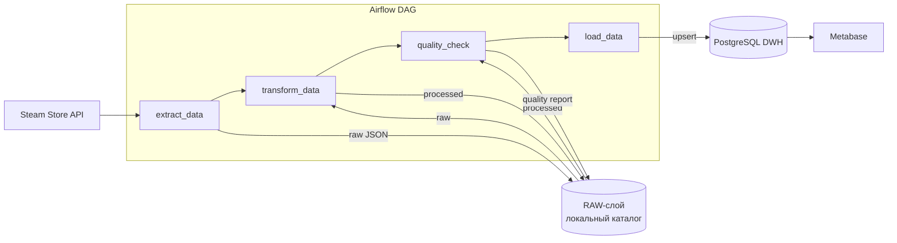

# steam-etl
ETL-конвейер для мониторинга цен и скидок в Steam. Собирает данные из публичного API, сохраняет исторические снапшоты в PostgreSQL, считает аналитику по жанрам и визуализирует в Metabase. Airflow, Docker Compose, RAW-слой, контроль качества и тесты.


## Архитектура



Данные хранятся в локальном каталоге `raw/` в двух логических слоях:

- `raw/` — исходные JSON-ответы API;
- `quality/` — отчёты о проверках качества.

Между задачами Airflow передаются ссылки на файлы в RAW-слое, а не большие наборы данных. Это позволяет не перегружать XCom.

## Технологический стек

| Компонент | Технология |
|---|---|
| Язык программирования | Python 3.10 |
| Оркестрация | Apache Airflow 2.7.3 |
| Источник данных | Steam Store API |
| Обработка данных | Pandas |
| Проверка качества | Явные проверки на Pandas + pytest |
| RAW-слой | Локальный каталог |
| Аналитическое хранилище | PostgreSQL 15 |
| Контейнеризация | Docker Compose |
| BI и визуализация | Metabase |
| Тестирование | Pytest, pytest-cov |

## Быстрый старт

### Требования

- Docker и Docker Compose;
- Git;
- доступ к интернету для получения данных из Steam API.

### Подготовка

Клонируйте репозиторий и перейдите в каталог проекта:

```bash
git clone https://github.com/bogdssd/steam-etl.git
cd steam-etl
```

Создайте файл конфигурации:

```bash
cp .env.example .env
```

Перед запуском заполните `.env`:

- задайте собственные пароли PostgreSQL;
- задайте пароль администратора Airflow;
- сгенерируйте корректный `AIRFLOW_FERNET_KEY`;
- задайте `AIRFLOW_SECRET_KEY`;
- проверьте параметры подключения и загрузки.

Для генерации Fernet-ключа:

```bash
python -c "from cryptography.fernet import Fernet; print(Fernet.generate_key().decode())"
```

Полученное значение необходимо записать в `AIRFLOW_FERNET_KEY`.

**Важно:** файл `.env` не следует публиковать в репозитории.

### Запуск

```bash
docker compose up -d --build
```

После запуска откройте Airflow, найдите DAG `steam_price_pipeline` и выполните `Trigger DAG`.

При ручном запуске можно передать параметры:

- `app_ids` — список идентификаторов игр для обработки;
- `load_mode` — режим загрузки: `incremental` или `full`.

### Доступ к сервисам

| Сервис | Адрес | Учётные данные |
|---|---|---|
| Airflow | http://localhost:8080 | `AIRFLOW_ADMIN_USER` / `AIRFLOW_ADMIN_PASSWORD` |
| PostgreSQL | localhost:5432 | `POSTGRES_USER` / `POSTGRES_PASSWORD` |
| Metabase | http://localhost:3000 | Настраивается при первом входе |

В Metabase после первоначальной настройки подключите аналитическую базу данных `steam_dwh`. Для построения отчётов доступны представления `v_*`.

> SQL-скрипты инициализации выполняются при первом запуске PostgreSQL с пустым томом. Изменение существующей схемы следует выполнять через миграции. Не удаляйте Docker volumes, если необходимо сохранить данные.

## Структура проекта

```text
steam-etl/
├── dags/
│   └── steam_price_dag.py
├── src/
│   ├── config.py
│   ├── extract.py
│   ├── transform.py
│   ├── quality.py
│   ├── load.py
│   └── pipeline.py
├── sql/
│   └── init.sql
├── tests/
│   ├── unit/
│   ├── integration/
│   └── system/
├── .env.example
├── .gitignore
├── docker-compose.yml
├── pytest.ini
└── requirements.txt
```

## Этапы ETL-конвейера

### 1. Extract — извлечение

- Запрос данных через Steam Store API по списку `appid`.
- Обработка сетевых ошибок и повторные запросы с экспоненциальной задержкой.
- Ограничение времени ожидания.
- Сохранение исходных данных в RAW-слой.

### 2. Transform — преобразование

- Приведение цен к `Decimal` (из копеек в рубли).
- Нормализация дат.
- Обработка бесплатных игр (отсутствие `price_overview`).
- Удаление дубликатов.
- Формирование уникального ключа `snapshot_key`.
- Расчёт аналитических признаков: скидка в рублях, процент скидки.

### 3. Quality — контроль качества

Проверки охватывают:

- полноту обязательных полей;
- уникальность идентификаторов;
- неотрицательность цен;
- допустимые диапазоны скидок.

Ошибки разделяются на два уровня:

- `critical` — критические нарушения, блокирующие дальнейшую загрузку;
- `warning` — предупреждения, сохраняемые в отчёте.

Результаты проверок сохраняются в каталог `quality/`.

### 4. Load — загрузка

- Загрузка обработанных данных в PostgreSQL.
- Пакетная запись данных.
- Использование `INSERT ... ON CONFLICT` для обновления существующих записей.
- Выполнение операций в транзакции.
- Поддержка инкрементального и полного режимов загрузки.

## Модель данных

Основные таблицы аналитического хранилища:

| Таблица | Назначение |
|---|---|
| `games` | Метаданные игр |
| `price_snapshots` | История цен и скидок |
| `discount_analysis` | Агрегированные показатели по жанрам |

Для идентификации снапшотов используется детерминированный ключ `snapshot_key`, формируемый на основе `appid` и даты сбора.

Для аналитики предусмотрены представления:

- `v_kpi` — основные показатели;
- `v_top_discounts` — самые большие скидки;
- `v_monthly_discounts` — динамика скидок по месяцам;
- `v_genre_analysis` — средние скидки по жанрам.

## Оркестрация и надёжность

DAG `steam_price_pipeline` состоит из четырёх последовательных задач:

```text
extract_data
     |
     v
transform_data
     |
     v
quality_check
     |
     v
load_data
```

Основные параметры:

| Параметр | Значение |
|---|---|
| Расписание | Ежедневно (`@daily`) |
| Catchup | Отключён |
| Максимум активных запусков | 1 |
| Количество повторных попыток | 3 |
| Начальная задержка между попытками | 2 минуты |
| Максимальная задержка | 30 минут |
| Тайм-аут задачи | 30 минут |
| Тайм-аут запуска DAG | 2 часа |

При ошибке задачи выполняются повторные попытки. После исчерпания попыток вызывается callback уведомления об ошибке. При успешном завершении DAG вызывается callback уведомления об успехе.

## Мониторинг

Для наблюдения за работой конвейера используются встроенные средства Airflow и витрина `pipeline_runs` в PostgreSQL, которая визуализируется в Metabase. Дашборд отображает динамику по дням: количество обработанных игр, успешных и неуспешных запусков, среднее время выполнения.

## Тестирование

Для запуска стандартного набора тестов:

```bash
docker compose exec airflow-webserver pytest
```

Настройки Pytest находятся в `pytest.ini`:

- каталог тестов — `tests/`;
- интеграционные тесты исключаются из стандартного запуска;
- минимальный порог покрытия кода — 70%;
- отчёт о покрытии выводится в терминал.

### Системные тесты

```bash
docker compose exec airflow-webserver pytest -m system -s --no-cov
```

### Интеграционные тесты

Интеграционные тесты требуют внешних сервисов и переменной `RUN_INTEGRATION=1`:

```bash
docker compose exec -e POSTGRES_DB=steam_test_dwh -e RUN_INTEGRATION=1 airflow-webserver \
    pytest tests/integration/test_real_services.py -m integration -s --no-cov
```

## Конфигурация

Основные параметры задаются через `.env`.

| Переменная | Назначение |
|---|---|
| `APP_IDS` | Список идентификаторов игр |
| `LOAD_MODE` | Режим загрузки |
| `POSTGRES_SSLMODE` | Режим проверки TLS-соединения PostgreSQL |

Полный список параметров и примеры значений приведены в `.env.example`.

## Безопасность

В проекте реализованы следующие меры:

- публикация портов PostgreSQL на локальном интерфейсе;
- хранение паролей и токенов в `.env`, а не в исходном коде;
- запрет публикации `.env` в Git.

Веб-интерфейсы Airflow и Metabase в текущей конфигурации доступны по HTTP. Поэтому проект рассчитан на локальный учебный стенд, а не на непосредственную публикацию сервисов в открытый интернет.

## Ограничения проекта

- Отслеживается сравнительно небольшой список игр, задаваемый в конфигурации.
- Региональные цены собираются только для одного региона.
- Историческая загрузка за прошлые периоды не предусмотрена.
- Доступность на уровне 99,9% требует длительного наблюдения за работой системы и не может быть подтверждена только тестами.
- Результаты производительности зависят от характеристик оборудования и конфигурации Docker.

## Автор

**богданка** ([@bogdssd](https://github.com/bogdssd))
```
